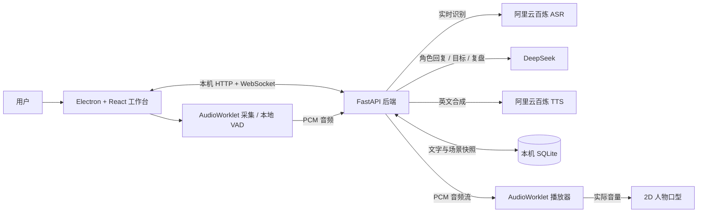
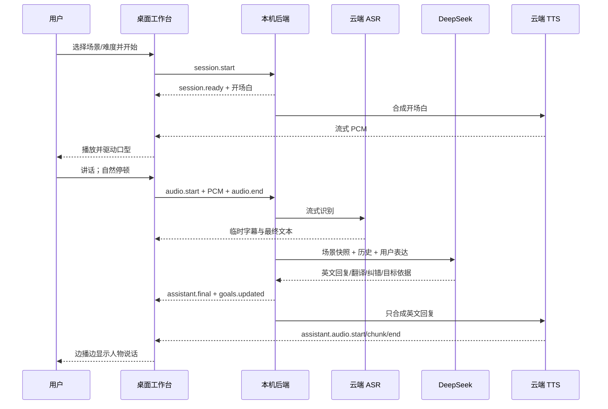

# Lingo Studio · 英语口语陪练——软件设计文档

| 文档属性 | 内容 |
| --- | --- |
| 文档编号 | LS-DESIGN-001 |
| 版本与日期 | 1.0 · 2026-10-02 |
| 状态 | 设计基线；未来功能均为规划，须按验收标准另行实现 |
| 对应产品 | Windows 个人版 0.2.5；朋友版源码原型另行标注 |
| 目标读者 | 产品负责人、设计师、开发与测试人员、后续维护者 |

| 修订版本 | 日期 | 变更内容 |
| --- | --- | --- |
| 1.0 | 2026-10-02 | 建立现状基线、架构与接口说明，加入 TTS、3D、男性角色和多人并发的设计及验收标准。 |

## 1. 文档目的与范围

本文说明产品目标、当前实现、模块边界、接口与数据、安全及异常处理，并定义下一阶段的四项设计：提高 TTS 自然度、将陪练形象升级为 3D、增加男性形象与配音、支持发布后的多人并发使用。文中使用以下状态词：

- **已实现**：已进入 0.2.5 个人版安装包，并有对应测试记录。
- **源码原型**：已开始编写，但未进入 0.2.5 安装包，也未完成上线验收。
- **规划**：设计方向和验收目标，不能据此宣称产品已支持。

本设计不是云服务账号、素材授权或收费承诺。云模型、音色与托管平台的可用性、价格和配额应以实施时的官方控制台与文档为准。当前个人版的验证证据见 [VALIDATION.md](VALIDATION.md)。

## 2. 产品目标

### 2.1 用户与场景

主要用户是需要反复练习实际英语对话的中文使用者。一次练习从选择或创建场景开始，经过听开场白、语音或文字应答、得到轻量反馈，最后在历史记录中查看复盘。陪练角色应帮助用户开口，而不是把会话变成连续的语法讲解。

### 2.2 设计目标

1. 提供可信的情境和自然的轮流对话，允许口音、短句、不完整表达及识别误差。
2. 让字幕、声音、嘴部动作和打断状态保持一致；用户停止播放后不再听到上一轮音频。
3. 让练习目标依据用户实际发言判断，并保留场景快照、纠错和复盘。
4. 个人版默认在本机保留练习历史；未来多人版按用户隔离数据和用量。
5. 不在客户端安装包中放置可供多人共用的 DeepSeek 或阿里云 API Key。

### 2.3 当前非目标

0.2.5 不提供离线 ASR/TTS、移动端、音素级口型、自动评分考试或公开多人服务。现有 2D 表情切换不称为 Live2D；仓库中的 3D 草稿也不是当前产品形象。

## 3. 当前产品边界与功能

| 能力 | 0.2.5 个人版状态 | 说明 |
| --- | --- | --- |
| 场景库 | 已实现 | 八个内置场景；自定义场景可生成、编辑、复制、删除。 |
| 难度 | 已实现 | A1、A2、B1、B2；默认 A2。选定等级用于后续 AI 回复；预设开场白和三个目标目前不随等级重新生成。 |
| 对话 | 已实现 | DeepSeek 生成英文角色回复、中文翻译、至多一条轻量纠错和目标依据。 |
| 输入 | 已实现 | 麦克风、临时 ASR 字幕、本地停顿检测与文字输入。 |
| 输出 | 已实现 | CosyVoice 流式 TTS、连续 PCM 播放、重听、打断和音频驱动的 2D 开闭口。 |
| 历史 | 已实现 | SQLite 保存文字、场景快照、目标进度和复盘；默认不保存用户录音。 |
| 多用户 | 源码原型 | 邀请码、用户隔离及用量限制已有初步代码；未部署、未打包、未完成并发与安全验收。 |
| 3D / 男性角色 | 规划 | 尚未进入当前安装版。 |

内置场景为咖啡店点单、餐厅用餐、酒店入住、机场出行、购物退换、问路交通、工作面试、日常社交。每个场景含双方身份、背景、开场白、三个目标及表达提示。自定义场景遵循“一句话描述 → AI 生成 → 编辑确认 → 保存”。

## 4. 总体架构

### 4.1 当前个人版

桌面主进程负责窗口、后端进程和本机配置。渲染进程负责界面、录音、VAD、流式播放和 2D 人物。FastAPI 后端只监听 `127.0.0.1`，管理会话、云服务调用和 SQLite。语音识别使用 `qwen-audio-3.1-asr-flash-streaming`，语音合成使用 `cosyvoice-v3-flash`；具体模型字符串在配置中确定。默认美式女声、语速 0.95，可选现有英式女声。

### 4.2 一轮对话的时序

播放期间暂停收音。打断时客户端立即停止播放器并清零嘴部状态，服务端取消剩余工作；会话 ID、轮次 ID 与播放器代次用于丢弃迟到事件。文字输入沿用同一轮次处理链路，绕过 ASR。

## 5. 模块设计

| 模块 | 主要职责 | 当前实现位置 |
| --- | --- | --- |
| 桌面主进程 | 单实例、窗口显示/恢复、读取加密配置、启动本机后端 | `electron/main.ts`、`electron/serviceConfig.ts` |
| 场景与练习界面 | 场景选择、难度、练习工作台、历史和偏好 | `src/App.tsx`、`src/components/` |
| 会话客户端 | 录音状态、轮次 ID、重试/打断、过期消息过滤 | `src/hooks/useConversation.ts`、`src/store/` |
| 音频播放器 | 连续 PCM 队列、预缓冲、缺包处理、口型能量 | `src/lib/audioPlayer.ts`、`public/pcm-*.js` |
| 2D 人物 | 原画叠加局部闭眼/张嘴素材、眨眼和轻微呼吸 | `src/components/Avatar2D.tsx`、`public/characters/` |
| 本机 API | 场景、会话、复盘、WebSocket 事件、取消 | `backend/app/application.py` |
| 云服务适配 | DeepSeek 对话、百炼 ASR/TTS | `backend/app/services/` |
| 持久化 | SQLite、旧表迁移备份、历史和自定义场景 | `backend/app/database.py`、`backend/app/models.py` |

### 5.1 音频与人物状态

采集侧使用 AudioWorklet 和本地 VAD，用户自然停顿约 0.9 秒后结束当前输入；百炼的临时结果只用于字幕，最终结果才提交给对话模型。输出侧先校验完整英文回复，再发送 TTS；翻译、纠错、提示不进入朗读。0.2.5 将各网络分包放入连续 PCM 播放队列，避免包边界独立重采样产生突变。输入 TTS 的 `&` / `&amp;` 转为 `and`，显示和历史文字仍保持原文。

当前 2D 人物沿用用户确认的 A 哑光版左侧半身原画，仅眼睛和嘴巴局部叠加表情素材。嘴巴依据实际播放能量切换；静音、停止与打断后立即闭合。动画或图片加载失败时，语音与文字练习不应被阻断。

### 5.2 会话状态与幂等

主要状态为准备、聆听、识别、思考、播放、文字可用、错误和结束。每次练习绑定场景快照；后续回复不能改用其他场景脚本。用户轮次使用请求 ID 去重，取消、超时、重试和关闭连接均须清理正在运行的 ASR、LLM 和 TTS 任务。前端只接受当前会话和当前轮次的结果，播放队列也使用代次清空旧音频。

## 6. 接口与数据契约

### 6.1 HTTP 接口（当前个人版）

| 路径 | 用途 |
| --- | --- |
| `GET /health` | 本机进程与服务配置状态。 |
| `GET /api/scenarios`、`GET /api/scenarios/{id}` | 场景列表与详情。 |
| `POST /api/scenarios/generate` | 根据描述和难度生成待确认草稿。 |
| `POST /api/scenarios`、`PUT/DELETE /api/scenarios/{id}` | 自定义场景增删改。 |
| `GET /api/sessions`、`GET/DELETE /api/sessions/{id}` | 练习历史与详情。 |
| `POST /api/sessions/{id}/review` | 结束后生成或读取中文复盘。 |

除健康检查外，HTTP 请求需携带本次启动的客户端凭据。健康检查只表示本机后端及配置状态，不等于云服务实时可用性证明。

### 6.2 WebSocket 事件（当前个人版）

单一入口 `/ws/conversation`。客户端关键事件为 `session.start`、`audio.start`、二进制 PCM 帧、`audio.end`、`text.submit`、`assistant.replay`、`turn.cancel`、`playback.complete`、`session.stop`。服务端关键事件为 `session.ready`、`transcript.partial/final`、`assistant.final`、`goals.updated`、`assistant.audio.start/chunk/end`、`turn.cancelled`、`session.ended` 与 `error`。消息中的 `session_id` 和 `turn_id` 用于归属和防止迟到结果污染新会话；错误事件需区分阶段，以便重试或转为文字练习。

### 6.3 数据模型与保留

- `Scenario`：场景 ID、来源、双方角色、背景、难度、开场白、三个目标及表达提示。
- `ConversationSession`：会话 ID、场景 ID 与快照、起止时间、状态、目标进度及复盘。
- `Turn`：说话方、文字、翻译、纠错、提示、轮次请求 ID 与时间。
- `CustomScenario`：用户确认保存的自定义场景内容。

个人版 SQLite 位于 `%APPDATA%/english-speaking-companion/cafe-lingo.db`。结构迁移前生成备份；异常退出的未结束会话标为“中断”。默认只保存文本、目标和复盘；用户原始录音不落盘，当前会话的回复音频仅内存缓存供重听。

## 7. 安全、隐私与故障处理

### 7.1 当前个人版

DeepSeek 与百炼密钥在开发阶段通过终端配置，使用 Electron `safeStorage` 加密为当前 Windows 账号可读的 `services.bin`；安装包不包含个人密钥。主进程把服务配置传给本机后端，渲染页面不直接接触提供商密钥。后端只监听回环地址，使用每次启动生成的临时客户端凭据。日志不应输出密钥和用户原始录音。

麦克风拒绝、ASR 空结果、云服务断网、鉴权失败、额度不足及 TTS 中断都应给出可理解的提示；在允许的状态下可重试或转为文字练习。启动配置读取失败时禁止以缺少密钥的后端继续运行。2026-10-01 曾出现一次个人版误报配置不完整、后端未启动；配置文件随后可解密，重启及两次冷启动恢复，具体瞬时原因尚未确认。后续修改启动流程时必须补足诊断记录和故障注入验证，不能把这次恢复视为根因已修复。

### 7.2 未来多人版原则

提供商 API Key 仅存放在托管服务的环境密钥中。安装包只含公开的服务地址；朋友首次输入一次性邀请码，之后在其 Windows 账号下保存独立凭据。所有个人数据按用户身份隔离，服务端需要邀请码撤销、日用量上限、总预算上限、连接数限制、审计与备份。任何面向公网的接口必须经 HTTPS/WSS 和服务端鉴权；不能仅凭客户端隐藏按钮、静态安装包密钥或来源 IP 控制费用。

## 8. 发布形态与现有源码原型

0.2.5 个人版使用 Electron + PyInstaller + NSIS 打包，后端随安装包在本机运行，保留现有应用标识与数据目录以支持覆盖升级。当前安装版没有代码签名，也没有多人服务能力。

仓库已有**未发布的朋友版源码原型**：`backend/app/cloud_gateway.py`、`backend/app/cloud_admin.py`、`electron/friendsConfig.ts` 以及客户端邀请码入口。这些文件尝试实现一次性邀请、独立用户数据库、短期 WebSocket 票据和用量限制；现有个人版安装包不包含这次源码修改。朋友版尚未完成托管平台部署、稳定性与并发压测、安全审查、持久存储和安装验收，因此不得作为已交付功能宣传。

## 9. 后续设计与验收

以下四项是需求优先级和设计方向；发布前需根据实际设备、模型配额、授权与预算确定最终阈值。每项都应先建立可重复的基线，再比较改动效果。

### 9.1 P1：继续优化 TTS 自然度

**问题与目标。** 当前 0.2.5 解决了可复现的音频分包边界不连续，也对 `&` 做了朗读文本处理；用户实际听感仍需在真实回复中验证。目标是让常见英语句子自然、清晰，减少突兀的高频噪声、停顿和不合理重音，同时保持低延迟和打断响应。

**设计路径。**

1. 建立固定试听集：覆盖连读、弱读、数字、日期、缩写、标点、`&`、专有名词和不同长度的场景回复。记录原始合成 PCM、网络分包边界及本地最终播放结果，区分云端合成瑕疵与播放器瑕疵；仅在用户明确同意时收集真实对话音频。
2. 比较同一句的不同可用音色、语速与必要的文本规范化。规范化只用于 TTS，字幕与历史保持原文；不得悄悄改写用户表达。更换模型或音色前核对官方支持范围、地域、费用和许可。
3. 维持连续 PCM 播放、明确采样率、短预缓冲及缺包淡入淡出；为网络抖动、结束、重听和连续打断设置回归测试。口型继续跟随真正播放的音频能量，而不是未播放完的服务端生成进度。
4. 同时记录首包时间、整句播放完成时间、断流次数和用户试听评价。试听由至少两人盲听固定样本，保留结果及可复现的失败样本；在评审前不宣称“自然度已经达标”。

**完成条件。** 固定试听集没有可复现的刺耳声；同一回复的实时播放与重听一致；网络分包变化不引入新爆音；打断后声和口型立即停止；自然度和延迟均有可对照的测量记录。若问题属于云端原始合成，记录提供商返回的合成版本及可复现语句，再决定换音色、文本处理或模型。

### 9.2 P2：将数字人升级为 3D

**设计原则。** 先以用户已认可的 A 哑光版 2D 人物作为造型基准，保留脸型、五官、发型、服饰主轮廓和哑光配色；3D 应是明确的新制作版本，不能把整张 2D 图片贴到平面上称为 3D。模型素材必须有可验证的来源、使用范围和可发布许可。

**制作流程。** 完成正侧背设定与表情表 → 制作低面数模型和贴图 → 绑定骨骼、眨眼及口部表情 → 导出可加载的 GLB/VRM 文件 → 检查桌面渲染与动作 → 由用户确认形象后接入主界面。渲染层封装统一的 `idle/listening/thinking/speaking` 状态；说话动画由实际播放能量驱动，停止或打断时立即闭嘴。保留“减少动画”和“低画质”，加载失败时退回已发布的 2D 人物，练习不中断。

**完成条件。** 用户确认外观；模型、贴图、许可说明与安装包一同交付；眨眼和呼吸自然，音频同步和打断正确；在约定的参考 Windows 设备上正常画质以稳定 30 FPS 为目标，并分别验证低画质、窗口缩放、显卡能力不足和模型加载失败。性能目标为设计目标，尚非当前实测结论。

### 9.3 P3：新增男性数字人与声音

**交互设计。** 在开始练习前选择陪练人物，人物选择与音色成对展示并可试听；偏好可记住默认选择，但每次会话保存实际使用的人物 ID、模型版本、音色 ID 和语速快照。切换人物只影响后续新会话，不改写历史。场景中的角色身份与人物外观需相符；自定义场景若指定不同身份，应给出可解释的选择或调整入口。

**实现约束。** 男性人物需要独立、可发布的原始设计及实际可加载的 2D/3D 资源，不能只换姓名或声音。男性音色须从实施时官方可用列表中选择，测试英语发音、地域权限、费用、流式格式和重听一致性；不要在文档阶段虚构音色 ID。人物和 TTS 的选择通过统一配置对象传给会话，服务端校验可用组合，避免角色、语音与历史记录串用。

**完成条件。** 男女两套人物和音色均可预览、切换、播放、打断及重听；语音与外观、字幕和会话快照一致；弱网络、音色不可用和模型加载失败时有明确提示和降级路径；新增素材许可记录完整。

### 9.4 P4：发布后支持多人并发

**分阶段方案。** 第一阶段面向受邀朋友：托管平台提供 HTTPS/WSS 地址，用户用一次性邀请码激活；DeepSeek 与百炼密钥仅由服务端持有。第二阶段再评估公开注册、账号找回、付费或配额管理。当前源码原型可作为实验起点，但单进程内存票据和每用户 SQLite 文件不应直接视为可横向扩容的生产架构。

**服务端设计。** 将客户端身份、会话、用量和请求记录持久化；所有查询附带服务端解析的用户 ID。针对 WebSocket 长连接设置每用户并发连接上限、心跳与断线恢复、每轮音频大小和时长上限。ASR、LLM、TTS 采用明确的并发限制、超时、取消、重试幂等和背压；当模型限流或预算达到阈值时拒绝新增付费请求，并让现有会话收到可理解的错误。长期运行与多实例需要共享的数据库、票据/会话状态和集中用量计数，不能依赖单进程内存锁或本地磁盘副本。

**隐私与运维。** 默认不落盘原始录音；分别定义文字历史保留期、用户删除和备份恢复流程。监控在线连接、排队时间、ASR/TTS/LLM 成功率、首字/首包延迟、断流、日费用与配额拒绝；日志只记录匿名化 ID、错误类别和耗时。邀请码和客户端凭据可撤销，泄露后不能获取其他用户历史或提供商密钥。

**完成条件。** 先确定目标并发人数和月预算，再分别进行 1、目标人数和两倍目标人数的语音会话压测；记录 p50/p95 延迟、成功率、内存、CPU、连接数和云服务费用。跨用户数据访问测试必须全部拒绝；配额到达后不再发起新的付费调用；服务重启或扩容后邀请码、历史和用量不丢失。未完成这些测试前不发布为“支持多人并发”。

## 10. 需求追踪与发布门槛

| 需求 | 设计章节 | 主要验证 |
| --- | --- | --- |
| 自然 TTS | 5.1、9.1 | 固定试听集、原始 PCM 与播放对照、分包/重听/打断回归。 |
| 3D 女性人物 | 5.1、9.2 | 外观确认、模型加载、动画同步、参考设备性能与 2D 降级。 |
| 男性人物和配音 | 9.3 | 素材许可、音色试听、人物/声音/会话快照一致性。 |
| 多人并发 | 7.2、8、9.4 | 身份隔离、并发压测、配额/预算、持久化与故障恢复。 |

每个版本至少完成相关单元与协议测试、TypeScript 检查、后端测试、生产构建、安装和覆盖升级检查。影响真实云调用的变更必须做受控联调，明确记录实际消耗与试听结论。发布说明应区分自动化通过、人工试听通过和仍待验证的项目。

## 11. 待决策事项

1. 3D 女性与男性人物的设计稿、建模方式、版权/发布许可及用户审美确认流程。
2. 男性英语音色的实际供应商、音色 ID、地域可用性和成本；TTS 优化是否需要更换模型。
3. 多人版首发是仅受邀朋友还是公开注册；目标并发人数、每人每日额度和月预算。
4. 托管平台、持久数据库、备份与数据保留期限；中国内地网络可达性与部署要求。
5. 个人版启动时偶发配置误报的根因及持续诊断方式。

## 12. 参考资料

- 项目现状：[README.md](README.md)、[VALIDATION.md](VALIDATION.md) 与对应源码；实现状态以实际安装版和验收记录为准。
- [阿里云百炼：语音识别模型概述](https://help.aliyun.com/zh/model-studio/asr-model)；[Qwen-Audio-ASR-Streaming 服务端事件](https://help.aliyun.com/zh/model-studio/qwen-audio-asr-streaming-server-events)。
- [阿里云百炼：语音合成模型与音色](https://help.aliyun.com/zh/model-studio/multimodal-timbre-list)。
- [Electron `safeStorage` 官方说明](https://www.electronjs.org/docs/latest/api/safe-storage)；[MDN AudioWorklet 说明](https://developer.mozilla.org/en-US/docs/Web/API/Web_Audio_API/Using_AudioWorklet)。
- 托管部署可参考平台的[公开地址](https://docs.railway.com/networking/public-networking)、[WebSocket 示例](https://docs.railway.com/guides/socketio)与[持久卷](https://docs.railway.com/volumes)文档；选型并不表示现已部署。

**术语：** ASR 为自动语音识别，TTS 为文本转语音，VAD 为语音活动检测，PCM 为未压缩采样音频，WebSocket 为支持双向实时消息的连接。本文的 p50/p95 指样本耗时的第 50/95 百分位值。
